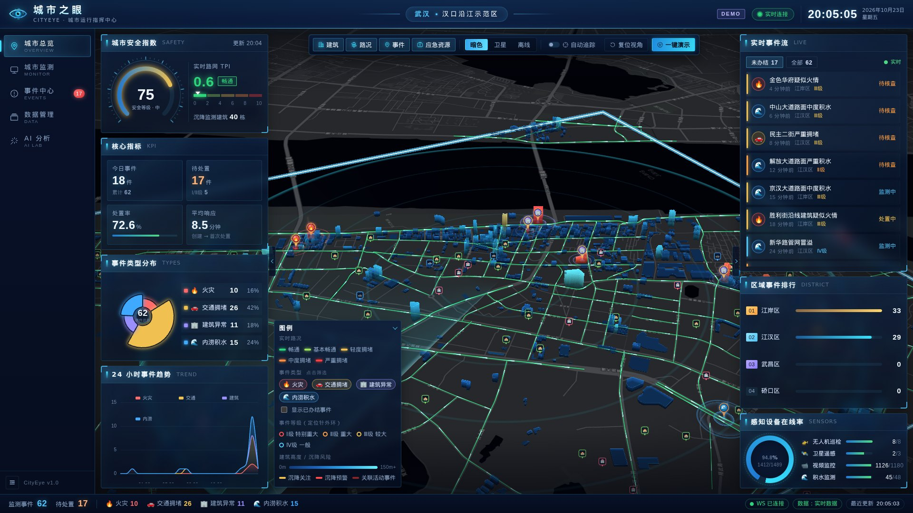
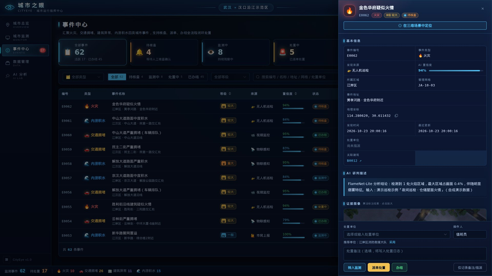
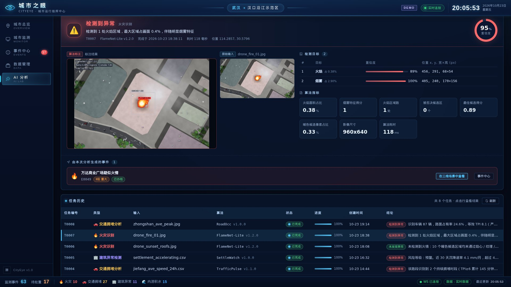
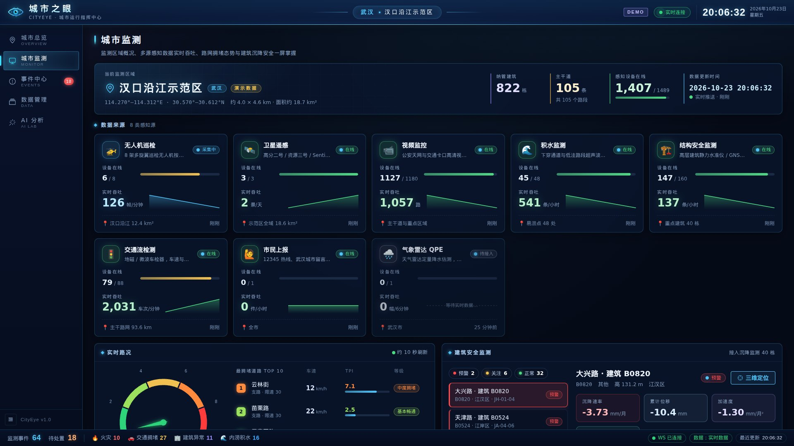
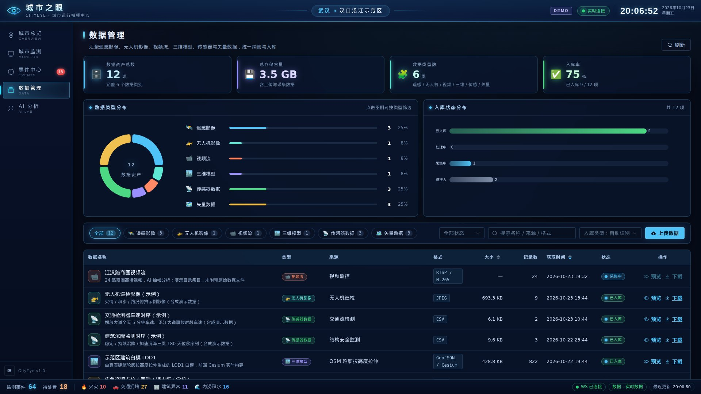
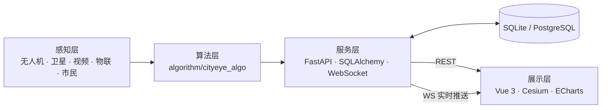

<div align="center">


# 城市智眼 · CityEye

**武汉城市智能监测与辅助治理平台** —— 感知 · 识别 · 研判 · 处置 · 复盘 全闭环的城市数字孪生指挥中心




</div>

---

## ✨ 亮点

| | |
| --- | --- |
| 🏙️ **七城区城市底座** | 武汉中心城区 **17458 栋概览建筑、111943 栋分区精细建筑**、955 条主次干道（1786 km）和 224 处医院/消防站/派出所/学校，覆盖江岸、江汉、硚口、汉阳、武昌、洪山、青山，支持区级网格编码 |
| 🛰️ **三维数字孪生** | Cesium 批量 Primitive 渲染 + 按区精细图层；接入黄鹤楼、武汉长江大桥 3D Tiles 地标；卫星底图优先在线加载，失败时显示全城 z13 概览并叠加汉口 z17 精图 |
| 🧠 **7 个真实可运行的算法** | 火灾识别、交通指数与短临预测、航拍车辆占有率、建筑沉降趋势、前后时相变化检测、积水水位研判、积水影像分割 —— 纯 NumPy 实现，**事件只由算法实际检出产生，绝不伪造** |
| ⚡ **实时闭环** | WebSocket 推送事件/路况/任务进度；事件状态机（待核查→监测中→处置中→已办结）后端校验；派单、办结、处置时间线多终端同步 |
| 🎬 **一键演示** | 打开页面先进入七城区平静基线；点击后执行 10 步故事线：城市感知 → 数字孪生 → 实时路况 → **全市随机异常识别** → 派单处置 → 沉降预警 → AI 追问 → 情景推演 → AI 分析 → 多城区异常增多统一监测。附字幕，Esc 可退出 |
| 🛟 **永不翻车** | 后端不可达时前端自动降级为「离线演示模式」（读取后端导出的真实数据快照），可直接部署到 GitHub Pages 等静态托管 |

## 📸 界面预览

| 事件中心 | AI 智能分析 |
| --- | --- |
|  |  |
| **城市监测** | **数据管理** |
|  |  |

## 🚀 快速开始

### 方式一：Docker（推荐，一条命令）

```bash
docker compose up --build
```

浏览器打开 <http://localhost:8000>。

默认优先加载 Esri 在线卫星瓦片；网络失败或超时时自动切换到
`frontend/public/basemap/wuhan-city-z13.jpg` 全城概览，并叠加汉口重点区
`wuhan-satellite-z17.jpg`。不预存全市 z17，因为该范围约需 1.7 万张瓦片、
估算超过 500 MB；当前离线缓存约 6.8 MB。

```bash
python scripts/download_satellite_basemap.py --bbox 114.15,30.45,114.55,30.72 --zoom 13 \
  --out frontend/public/basemap/wuhan-city-z13.jpg
```

### 方式二：本地运行

环境要求：Python ≥ 3.10、Node.js ≥ 18。

```bash
make install   # 安装前后端依赖
make demo      # 构建前端并由后端单端口托管 → http://127.0.0.1:8000
```

开发模式（后端热重载 + Vite HMR）：

```bash
make dev       # 后端 :8000（Swagger /docs） + 前端 :5173
```

Windows 路演可直接双击项目根目录的 `start-demo.cmd`。脚本会检查构建产物、
启动隐藏后端并打开浏览器；需要强制重建时运行：

```powershell
.\start-demo.ps1 -Rebuild
```

若本地已有黄鹤楼与长江大桥 3D Tiles 压缩包，先解压到前端静态目录：

```powershell
python scripts/prepare_3d_tiles.py
```

地标资产约 272 MB，已被 `.gitignore` 排除，只作为本地/镜像构建输入。

首页默认进入平静基线。每次点击“一键演示”前会恢复固定种子数据，清除人工上报、
历史分析任务和上一轮演示产生的数据，适合连续路演。

<details>
<summary>不使用 make</summary>

```bash
pip install -r backend/requirements.txt
cd frontend && npm ci && npm run build && cd ..
python -m backend            # 首次启动约 3 秒自动生成演示数据
```
</details>

### 方式三：纯静态（无后端）

```bash
cd frontend && VITE_USE_MOCK=true npm run build   # 产物在 frontend/dist，可直接静态托管
```

仓库已内置 GitHub Pages 工作流（`.github/workflows/pages.yml`）：在仓库 **Settings → Pages → Source** 选择 **GitHub Actions** 即可自动发布离线演示站点。

## 🗺️ 功能导览

| 页面 | 核心能力 |
| --- | --- |
| **城市总览** | 七城区三维底座 + 指挥大屏；底部城区导航按需加载精细建筑；图层含概览建筑、分区建筑、黄鹤楼/长江大桥地标、路况、事件与应急资源 |
| **城市监测** | 无人机/卫星/视频/物联四类数据源在线率与实时吞吐火花图；路网 TPI 仪表与拥堵排行；建筑沉降监测清单与沉降曲线 |
| **事件中心** | 多维筛选（类型/状态/等级/关键词）、人工上报、事件详情抽屉（证据图、算法指标、处置时间线）、按状态机派单/办结/重开、三维定位 |
| **数据管理** | 空间数据资产清单（遥感/无人机/视频/三维模型/传感器/矢量）、类型与状态分布、拖拽上传入库 |
| **AI 分析** | 4 类分析 × 18 份示例数据或自有数据上传；实时进度；标注结果图、检测框、指标、时序与预测曲线；检出即生成事件并可在三维场景定位 |
| **虚拟人群仿真** | Three.js 低模人物叠加 Cesium 城市场景；支持人员类型、1—1000 人批量分布、单人路径运动、区域聚集、危险区疏散、实时统计与性能测试 |
| **应急演练** | 独立平静基线页面：按火灾、交通、积水或建筑异常固定场景推演，支持 1/4/8 倍速、动态风险场、四出口、风险加权路径、出口排队、过程时间线和完成摘要 |
| **智能情景推演** | 输入一句话生成火灾、内涝或交通情景；演示模式自动补齐参数并生成常规、不利、干预三套可能结果，支持三维回放、时间轴、方案对比和结构化报告 |

5 分钟路演脚本见 [docs/demo-script.md](docs/demo-script.md)。

虚拟人群仿真的技术融合、坐标转换、接口和实测记录见
[docs/crowd-simulation.md](docs/crowd-simulation.md)。
城市智能情景推演的架构与接口见
[docs/scenario-simulation.md](docs/scenario-simulation.md)。
界面层级、色彩、响应式导航与视觉验收记录见
[docs/interface-design.md](docs/interface-design.md)。

## 🕸️ 代码图谱

项目已使用 Graphify 生成持久化代码知识图谱，覆盖前端、后端、大模型、情景引擎、算法和数据处理代码：

- 3163 个节点、7304 条关系边、151 个社区
- [交互式代码图](graphify-out/graph.html)
- [调用流程与架构图](graphify-out/CALLFLOW.html)
- [图谱审计报告](graphify-out/GRAPH_REPORT.md)
- [GraphRAG JSON](graphify-out/graph.json)

代码更新后可增量重建，不需要调用大模型：

```bash
graphify update .
```

## 🏗️ 系统架构



| 层 | 目录 | 技术栈 |
| --- | --- | --- |
| 展示层 | [`frontend/`](frontend) | Vue 3.5 · TypeScript(strict) · Vite 5 · CesiumJS 1.125 · Element Plus · ECharts 5 |
| 服务层 | [`backend/`](backend) | FastAPI · SQLAlchemy 2 · Uvicorn · WebSocket · 异步任务线程池 · 城市感知模拟器 |
| 算法层 | [`algorithm/`](algorithm) | NumPy · Pillow（无 GPU、无深度学习框架依赖，可插拔替换） |
| 数据层 | [`data/`](data) · [`database/`](database) | OpenStreetMap 城市底座 · 合成演示样本 · 库表结构 |

详见 [docs/architecture.md](docs/architecture.md)，接口契约见 [docs/api.md](docs/api.md)。

## 🧠 算法

| 类型 | 算法 | 方法 | 输入 |
| --- | --- | --- | --- |
| 🔥 火灾 | **FlameNet-Lite** | YCbCr + HSV 火焰色彩规则、形态学、连通域、焰心/纹理/形状校验、烟雾邻域分析 | 无人机/视频帧 |
| 🚗 交通 | **TrafficPulse** | 相对速度 → TPI 五级映射、持续拥堵时段识别、阻尼 Holt 短临预测 | 车速时序 CSV |
| 🚗 交通 | **RoadOcc** | 沥青路面掩膜、局部背景差分、连通域车辆计数 → 路面占有率 | 航拍图像 |
| 🏢 建筑 | **SettleWatch** | Theil–Sen 稳健趋势、二次拟合加速度、滚动 MAD 异常、分级阈值 | 沉降监测 CSV |
| 🏢 建筑 | **ChangeScope** | 辐射归一化、灰度/梯度差分融合、Otsu 自适应阈值、连通域 | 前后时相影像对 |
| 🌊 内涝 | **AquaLevel** | 分级水位阈值、涨水速率、雨洪互相关滞后、ARX 降雨-径流预测 | 水位/降雨 CSV |
| 🌊 内涝 | **AquaSeg** | 低纹理 × 水体色彩似然、Otsu、形态学、连通域 | 航拍图像 |

18 份示例（含 7 份**反例**，如「黄昏红瓦屋面与橙色车辆」易误报场景）全部由单元测试断言：正例必须检出、反例必须不检出。
算法细节、阈值依据与实测结果见 [docs/algorithms.md](docs/algorithms.md)。

> **诚实声明**：示例影像与时序为按算法假设生成的**合成数据**（影像由真实 OSM 建筑轮廓渲染），用于验证实现正确性，不代表真实场景准确率。
> 模拟器只负责「喂数据」，是否产生事件完全取决于算法在输入上的实际运行结果。生产部署可在 `registry.py` 中替换为 YOLO / SegFormer 等深度模型，接口不变。

## 🔌 API 一览

| 方法 | 路径 | 说明 |
| --- | --- | --- |
| GET | `/api/events` · `/api/events/{id}` · `/api/events/{id}/logs` | 事件列表（类型/状态/等级/关键词筛选）、详情、处置日志 |
| POST · PATCH | `/api/events` · `/api/events/{id}` | 人工上报；状态流转/派单（状态机校验，非法流转 409） |
| GET | `/api/buildings` · `/api/buildings/fine?district=武昌区` · `/api/buildings/{id}` · `/api/roads` · `/api/pois` | 全市概览、分区精细建筑、建筑沉降详情、实时路况、应急资源 |
| GET | `/api/stats/overview` | 大屏指标：KPI、分布、24h 趋势、城市指数 |
| GET · POST | `/api/data` · `/api/data/stats` · `/api/data/upload` | 数据资产 |
| GET · POST | `/api/tasks` · `/api/tasks/upload` · `/api/samples` | AI 分析任务（示例数据 / 上传文件） |
| GET | `/api/sources` · `/api/system/info` · `/api/health` | 数据源、系统信息、健康检查 |
| POST | `/api/demo/scenario` · `/api/demo/reset` | 演示控制：触发场景 / 重置数据 |
| GET · POST | `/api/llm/status` · `/api/llm/parse-task` · `/api/llm/chat` · `/api/llm/report` | 大模型状态、任务解析、多轮治理问答和事件研判报告 |
| GET · POST | `/api/scenario/status` · `/api/scenario/sessions` · `/api/scenario/runs/{id}` | 情景会话、参数版本、模拟推演、对比与报告 |
| WS | `/api/ws` | `event.created` · `event.updated` · `task.updated` · `traffic.updated` · `sensor.tick` |

启动后访问 <http://127.0.0.1:8000/docs> 查看交互式 Swagger 文档。

## ⚙️ 配置

| 环境变量 | 默认值 | 说明 |
| --- | --- | --- |
| `CITYEYE_DB_URL` | `sqlite:///backend/var/cityeye.db` | 数据库连接（可换 PostgreSQL） |
| `CITYEYE_DEMO_MODE` | `true` | 开放演示控制接口 |
| `CITYEYE_SIMULATOR` | `true` | 城市感知数据流模拟器 |
| `CITYEYE_SIM_INTERVAL` | `45` | 巡检间隔（秒）；路况 10s、传感 5s |
| `CITYEYE_RESET_ON_START` | `false` | 启动时重置演示数据 |
| `CITYEYE_FRONTEND_DIST` | `frontend/dist` | 托管的前端构建目录 |
| `CITYEYE_MAX_UPLOAD_MB` | `20` | 单文件上传大小上限（MB） |
| `CITYEYE_FINE_BUILDINGS_PATH` | `data/datasets/derived/buildings/wuhan_demo_buildings.geojson` | 精细建筑兼容入口；七城区分块位于同目录 `districts/` |
| `VITE_USE_MOCK` | `false` | 前端强制使用离线快照 |
| `VITE_BASEMAP` | `satellite` | 底图：`satellite` / `dark` / `offline` |
| `VITE_CESIUM_ION_TOKEN` | 空 | 可选，启用 Cesium Ion 在线地形/影像 |

前端变量示例见 [`frontend/.env.example`](frontend/.env.example)。

## 🧪 测试

```bash
make test
# algorithm/tests  53 passed   —— 每个算法的正例/反例/边界
# backend + llm_module + scenario_engine  68 passed —— REST、任务、LLM、情景推演
# frontend  49 passed          —— 人群、路网、事件优先级、格式化与 HTTP 层
# scripts   3 passed           —— 卫星底图范围、裁切和 URL 生成
cd frontend
npm run lint                   # ESLint（Vue + TypeScript）
npm run test                   # Vitest
npm run build                  # vue-tsc 严格类型检查 + 生产构建
```

GitHub Actions（`.github/workflows/ci.yml`）在每次推送时自动运行以上检查。

## 📁 目录结构

```
wuhan-zhiyan/
├── frontend/                 # Vue 3 + Cesium 前端
│   ├── src/components/scene/ #   三维图层：建筑 / 路网 / 事件 / POI / 着色器 / 导览
│   ├── src/components/dashboard/  # 指挥大屏面板
│   ├── src/components/pages/ #   业务页面组件
│   ├── src/api/              #   接口层（live / offline / mock 三态）
│   ├── public/basemap/       #   本地卫星底图缓存
│   └── public/snapshot/      #   后端导出的离线数据快照
├── backend/                  # FastAPI 服务（python -m backend）
│   └── app/{routers,services}#   路由 / 事件状态机 / 任务 / 模拟器 / 实时推送 / 统计
├── algorithm/cityeye_algo/   # 7 个分析器 + 注册表
├── data/
│   ├── geo/                  # OSM 城市底座（GeoJSON）
│   ├── samples/              # 18 份合成演示样本 + manifest
│   └── scripts/              # OSM 抓取加工、样本生成、航拍渲染
├── database/                 # schema.sql + ER 图
├── docs/                     # 架构 / API 契约 / 算法 / 路演脚本
├── graphify-out/             # 代码图 JSON / HTML / 调用流 / 审计报告
├── scripts/                  # dev.sh / demo.sh / export_snapshot.py
├── Dockerfile · docker-compose.yml · Makefile
```

## 🛣️ 路线图

- [x] 第 3 周：前端原型（Cesium 场景、五大页面、API 接口层）
- [x] 第 4 周：FastAPI 后端、算法层、实时推送、处置闭环、OSM 真实城市底座、离线演示模式
- [ ] 接入真实无人机/视频流（RTSP → 抽帧 → 推理）
- [ ] 深度模型替换（YOLOv8 火焰/烟雾、SegFormer 积水分割），沿用现有注册表接口
- [x] 黄鹤楼、长江大桥 3D Tiles 与按区建筑精细图层
- [ ] Cesium World Terrain
- [ ] PostgreSQL + PostGIS、权限与多租户、移动端处置 App

## 📚 数据来源与致谢

- 建筑、道路、行政区、POI：© [OpenStreetMap](https://www.openstreetmap.org/copyright) contributors，ODbL 1.0。缺少高度标签的建筑按占地面积与类别估算高度，并在 `height_source=estimated` 中如实标注。
- 七城区应急资源点通过 OpenStreetMap Nominatim 补充，并按名称、类型和空间距离去重；未查到明确设施时不做随机补齐。
- 底图：© Esri（World Dark Gray Canvas / World Imagery）；离线底图为 CesiumJS 自带 Natural Earth II。
- 本地卫星缓存仅用于演示；全城只保存 z13 概览，重点区保存 z17 精图。使用和再分发前请核对 Esri World Imagery 服务条款。
- 三维引擎：[CesiumJS](https://cesium.com/platform/cesiumjs/)；图表：[Apache ECharts](https://echarts.apache.org/)；UI：[Element Plus](https://element-plus.org/)。
