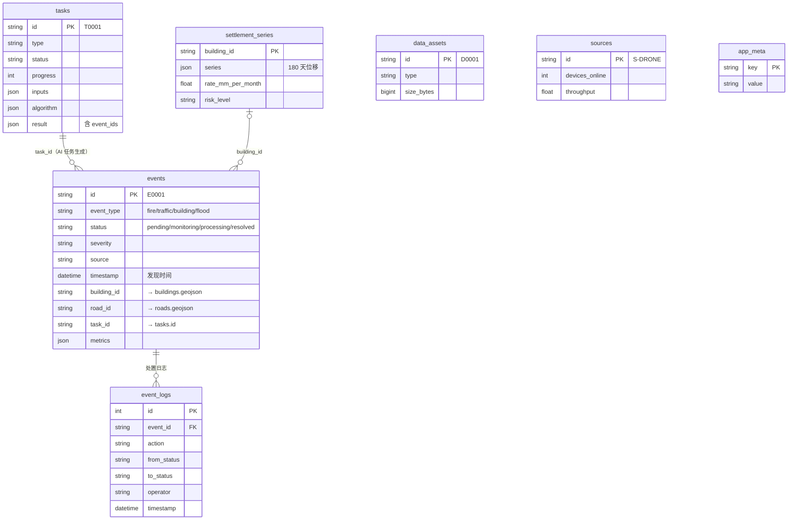

# 数据库设计

后端使用 SQLAlchemy 2.x ORM（`backend/app/models.py`），默认 SQLite（`backend/var/cityeye.db`，WAL 模式），
可通过环境变量 `CITYEYE_DB_URL` 切换到 PostgreSQL / MySQL。`schema.sql` 是与 ORM 一致的 DDL（SQLite 方言，附字段注释），
应用启动时会自动建表，无需手工执行。

## ER 图

建筑与道路的几何、属性来自 `data/geo/*.geojson`（OpenStreetMap，ODbL），不入库；`events.building_id / road_id`
与 `settlement_series.building_id` 按文件中的编号关联。编号会在地理数据重新生成时变化，因此种子数据每次都从文件派生，
不写死任何编号。

## 表说明

| 表 | 说明 |
| --- | --- |
| `events` | 城市事件。`status` 按状态机流转（非法流转 API 返回 409）；`metrics` 保存算法指标；`evidence_url` 指向算法标注图 |
| `event_logs` | 事件处置时间线：`created` / `ai_detected` / `status_changed` / `assigned` / `comment`，随事件级联删除 |
| `tasks` | AI 分析任务，`result` 为 docs/api.md §6 的 `AnalysisTask.result`（检测框、指标、产物、时序、生成的事件） |
| `settlement_series` | 接入沉降监测的建筑：位移时序 + SettleWatch 算法计算的速率 / 加速度 / 风险等级 |
| `data_assets` | 数据资产目录（含 OSM 矢量、示例数据与演示目录条目，上传文件也登记于此） |
| `sources` | 监测数据源基线配置，实时吞吐由模拟器在内存中刷新 |
| `app_meta` | 种子版本与生成时间 |
| `scenario_sessions` | 多轮情景推演会话、当前参数和消息 |
| `scenario_versions` | 不可变情景参数版本，用于修改前后对比 |
| `scenario_runs` | 推演时间帧、提供方、数据性质和结构化报告 |

道路实时路况（车速 / TPI / 等级）只存在于内存（`services/traffic.py`），通过 `GET /api/roads` 与 WebSocket `traffic.updated` 输出。

## 种子数据（`backend/app/seed.py`）

首次启动（库中无 `seed_version`）、`CITYEYE_RESET_ON_START=true` 或调用 `POST /api/demo/reset` 时生成，约 3 秒：

1. **数据源 8 个、数据资产 12 条**：OSM 建筑 / 道路 / POI 的条目使用真实文件大小与记录数；没有附带文件的遥感目录条目注明"演示目录条目"。
2. **沉降监测 40 栋**：汉口侧最高的 40 栋建筑，生成 180 天位移序列（多数稳定，少数持续沉降 / 加速沉降，风险剖面优先放在无名建筑上），
   风险等级由 SettleWatch 算法计算。
3. **AI 任务 8 个**：在示例数据上真实运行算法（含 1 个红瓦屋面反例，结论为未检出）。
4. **近 7 天约 50 个事件**：
   - 图片类事件的证据图来自示例影像的真实分析结果；
   - 交通 / 内涝 / 沉降事件由与实时模拟器同一模型生成的历史序列（车速、水位 + 雨量、位移）经 TrafficPulse / AquaLevel / SettleWatch 分析得到，**未检出则不生成事件**；
   - 包含 3 天前一场暴雨引发的多点内涝、每日早晚高峰拥堵、交通事故、市民上报（含 1 起核查为误报的冒烟）；
   - 每个事件的处置时间线（响应、派单、现场反馈、办结）按类型推演到当前时刻截断，因此越久远的事件越可能已办结，日志与状态一致。

随机数固定（`random.Random(42)`），时间相对当前时刻生成，所以演示数据始终是"最近 7 天"。
