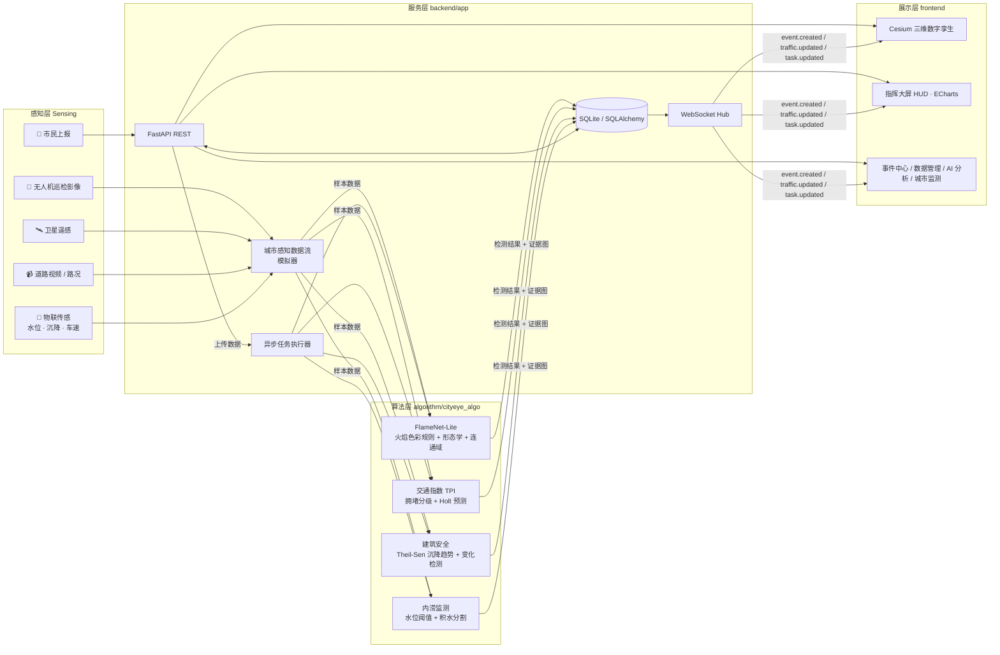
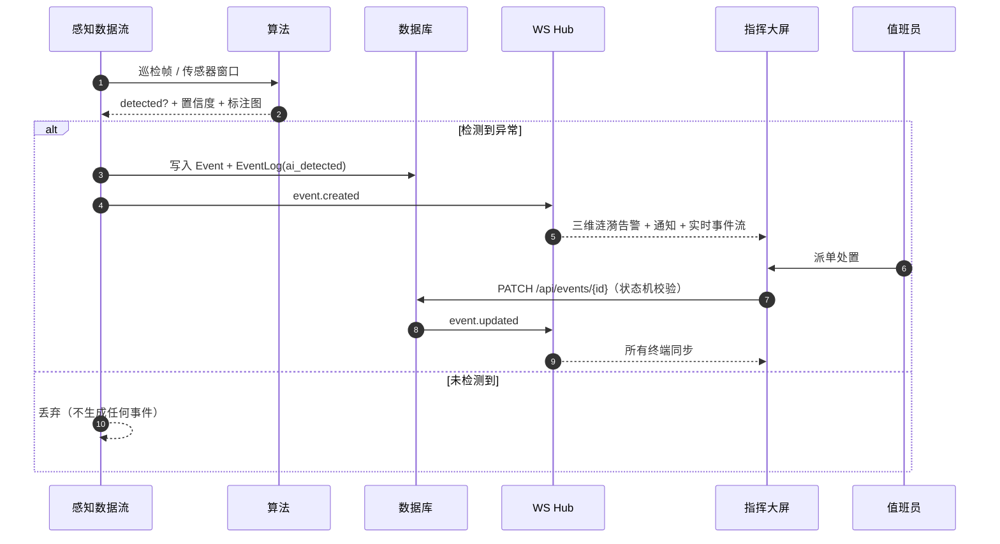

# 系统架构

城市之眼（CityEye）是面向城市运行管理的「**感知 → 识别 → 研判 → 处置 → 复盘**」闭环平台。
本文描述 v1.0 的整体架构、数据流与关键设计取舍。

## 1. 总体架构

| 层 | 目录 | 技术 | 职责 |
| --- | --- | --- | --- |
| 展示层 | `frontend/` | Vue 3.5 · TypeScript · Vite 5 · Cesium 1.125 · Element Plus · ECharts 5 | 三维城市场景、指挥大屏、业务页面、实时订阅 |
| 服务层 | `backend/` | FastAPI · SQLAlchemy 2 · Uvicorn · WebSocket | REST/WS 接口、事件状态机、异步任务、统计、实时模拟 |
| 算法层 | `algorithm/` | NumPy · Pillow | 火灾识别、交通指数、建筑沉降/变化检测、内涝监测 |
| 数据层 | `data/` `database/` | OpenStreetMap · 合成样本 · SQLite | 真实城市底座、演示样本、库表结构 |

## 2. 关键数据流

### 2.1 实时事件闭环

> **诚实原则**：模拟器只负责「喂数据」，是否产生事件**完全由算法在输入上的实际运行结果决定**；
> 负样本（如橙红色屋顶、夕阳色车辆）同样会进入流水线，算法未检出则不产生事件。

### 2.2 AI 分析任务

`POST /api/tasks` / `POST /api/tasks/upload` → 任务入库（pending）→ 线程池执行算法
→ 进度 10/35/70/100 通过 `task.updated` 推送 → 结果（检测框、指标、时序、标注图）落库
→ 若检出且带位置，自动生成 `source=ai_task` 的事件并在三维场景定位。

## 3. 三维场景设计

- **城市底座**：OpenStreetMap 真实建筑轮廓（汉口沿江示范区），按高度拉伸；以单个 `Primitive` +
  `GeometryInstance` 批量渲染，保证上千栋建筑 60fps。
- **底图**：Esri 暗色画布 / Esri 卫星 / Cesium 离线 NaturalEarthII 三选一，在线底图失败自动回退离线。
- **路况**：主干路按 TPI 五级着色并随 `traffic.updated` 实时刷新。
- **事件**：类型图标 + 等级光环 + 脉冲涟漪；新事件强提示并可自动追踪。
- **建筑安全**：接入沉降监测的建筑按风险等级着色，点击查看沉降曲线。

## 4. 运行模式

| 模式 | 触发 | 数据来源 | 说明 |
| --- | --- | --- | --- |
| live | 后端在线 | FastAPI + WebSocket | 全功能：实时事件、算法任务、处置闭环 |
| offline | 后端不可达时自动降级 | `frontend/public/snapshot` 快照 | 可浏览全部页面，处置操作仅本地生效，AI 任务提示需启动后端 |
| mock | `VITE_USE_MOCK=true` 构建 | 同上 | 适合 GitHub Pages 等纯静态托管 |

快照由 `scripts/export_snapshot.py` 从后端真实接口导出，保证离线界面与在线一致。

## 5. 扩展点

- **算法替换**：`algorithm/cityeye_algo/registry.py` 按事件类型注册分析器，可无缝替换为 YOLO / SegFormer 等深度模型，接口不变。
- **数据库**：`CITYEYE_DB_URL` 切换为 PostgreSQL/PostGIS（SQLAlchemy 方言无关）。
- **三维数据**：配置 `VITE_CESIUM_ION_TOKEN` 后可叠加 Cesium World Terrain、倾斜摄影 3D Tiles。
- **新事件类型**：在 `docs/api.md` 枚举、`frontend/src/types/event.ts` 元信息、算法注册表三处追加即可。
